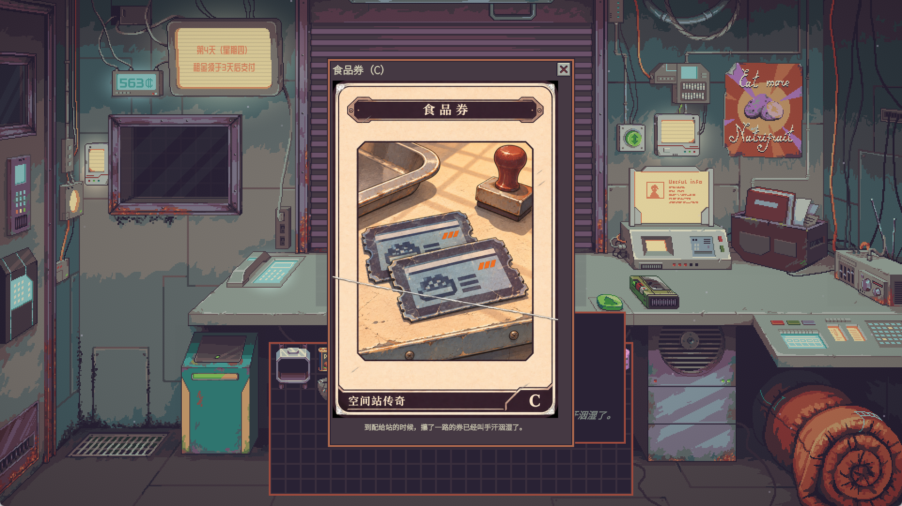

# 可能是集换卡牌

**Probably Trading Cards** 是《Probably Stolen》的简体中文模组。在空间站店铺里经营《空间站夜话》和《空间站传奇》两辑卡牌。向散货商和发行商进货，原封转卖或拆包，陈列稀有卡招揽收藏客，也可以把喜欢的卡留在集换册里。

[订阅 Steam 创意工坊](https://steamcommunity.com/sharedfiles/filedetails/?id=3842861920)、[GitHub 安装包](https://github.com/XJfyrh/ProbablyTradingCards/releases/latest)、[玩家指南](ProbablyTradingCards/README.md)、[反馈与建议](https://github.com/XJfyrh/ProbablyTradingCards/issues/new/choose)



## 安装与游玩

- **Steam 创意工坊**。订阅后，在游戏的「模组」菜单启用「可能是集换卡牌」，按提示审核并重启。若之前手动安装过，请先将同 ID 的副本移出 `Mods`。
- **GitHub**。从 [Releases](https://github.com/XJfyrh/ProbablyTradingCards/releases) 下载 `ProbablyTradingCards-v<版本>.zip`，把解压出的 `ProbablyTradingCards` 文件夹放入游戏的 `Mods`，再启用并重启。同一时间使用其中一个安装来源。

第一次进货、拆包、收藏和卸载见[玩家指南](ProbablyTradingCards/README.md)。

## 构建模组

在 Windows 上准备 .NET 10 SDK、Python 和已安装的《Probably Stolen》正式版。在仓库根目录运行 PowerShell，将游戏路径换成你自己的安装目录。

```powershell
$env:PROBABLY_STOLEN_GAME_DIR = 'C:\Games\Probably Stolen'
python -m venv .venv
./.venv/Scripts/python.exe -m pip install -r scripts/requirements.txt
dotnet build ProbablyTradingCards/ProbablyTradingCards.csproj -c Release
```

正式包在 `ProbablyTradingCards/dist/ProbablyTradingCards/`。也可以通过 `-p:GameDir` 和 `-p:PythonExe` 单独指定构建环境。要运行整套离线检查，先按测试说明补装注释解析依赖，再运行 `./tests/verify.ps1`。[构建模组并运行离线测试](tests/README.md#构建模组并运行离线测试)

## 制作扩展

- [《码头来信》](Examples/DockLetters/README.md)是可导出的卡辑模板，包含两张卡、清单、卡面和独立打包命令。
- [《收藏悬赏》](Examples/CollectionBounty/README.md)是玩法模板，示范如何识别其他作者的实体卡并在成交后发放奖励。
- [新增卡辑](docs/development/新增卡辑.md)和[外部模组接口](docs/development/外部模组接口.md)说明清单、注册、存档标识和实体卡查询。

## 项目资料

| 想查什么 | 入口 |
| --- | --- |
| 出率、供货和顾客 | [卡池与供货](docs/design/卡池与供货.md)、[卡牌目录](docs/design/卡牌目录.md)、[顾客与展示柜](docs/design/顾客与展示柜.md) |
| 收藏簿和存档 | [异画与收藏簿（含剧透）](docs/design/异画与收藏簿.md)、[物品与存档](docs/development/物品与存档.md) |
| 卡面和包装 | [美术规范](docs/art/美术规范.md)、[美术导出](scripts/README.md) |
| 尚未实装的点子 | [玩法构想](docs/ideas/玩法构想.md) |
| 发布、许可和素材来源 | [发布指南](docs/release/README.md)、[代码许可证](LICENSE)、[授权范围与素材来源](ProbablyTradingCards/CREDITS.md) |

## 参与贡献

欢迎提交 Bug 或玩法建议，也欢迎改文档、修问题和制作扩展。[贡献指南](CONTRIBUTING.md)说明如何提交和验证改动。
